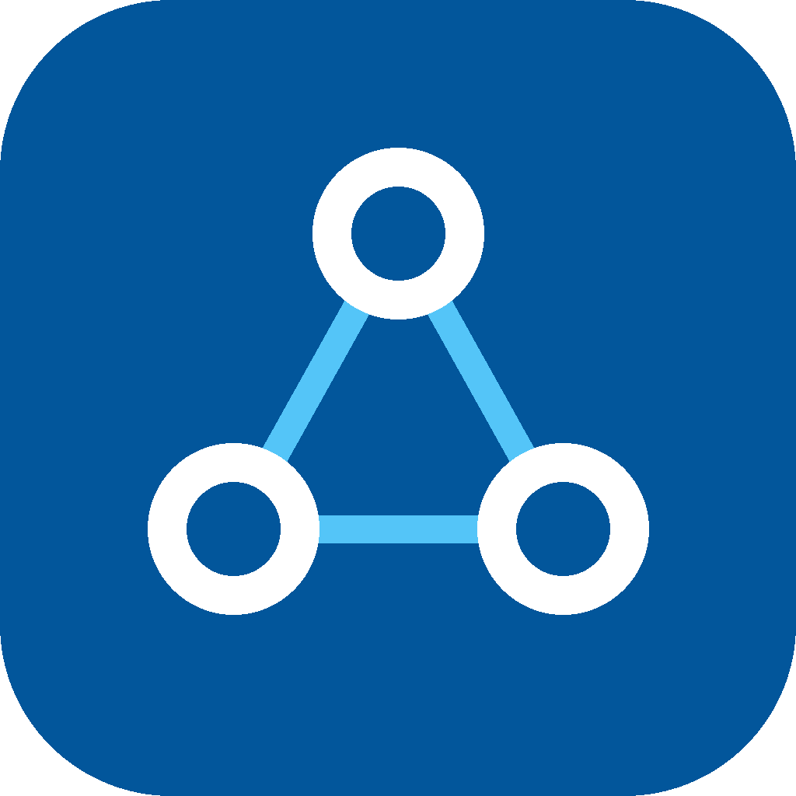

<div align="center">



# Flutter Agent Team

**A team of AI agents for Flutter apps: from ticket to reviewed pull request, in your project's own architecture.**

Works with **Claude Code** and **Cursor**. Open source, MIT.

[Install](#install) · [Quick start](#quick-start) · [The team](#the-team) · [Profiles](#stack-profiles) · [How it works](docs/how-it-works.md) · [Roadmap](#roadmap)

</div>

---

## Why

Generic AI coding assistants write Flutter code that compiles but ignores *your* architecture, invents API fields, skips error and offline states, and claims tests passed that never ran.

Flutter Agent Team fixes that with three ideas:

1. **Roles, not one generalist.** Seven specialised agents plan, build, test, review and debug. Reviewers and planners are read-only, so the agent that writes code never grades its own work.
2. **Your project is the source of truth.** A one-time `/agent-team-init` detects your architecture and state management, names the feature agents should copy, and lists the code they must not copy.
3. **Discipline that is enforced, not just asked for.** Every agent follows the same non-negotiables (verify before use, stay in scope, honest reporting, approval gates), and guard hooks block edits to generated files, reads of secret files and destructive shell commands.

## Install

**Claude Code**

```text
/plugin marketplace add MokarmDev/flutter-agent-team
/plugin install flutter-agent-team@flutter-agent-team
```

**Cursor**

Settings → Plugins → Import from Repo → `https://github.com/MokarmDev/flutter-agent-team`

**Recommended alongside** (we build on them instead of copying them):

- The official **Dart and Flutter** plugin, which adds the Dart MCP server (analyzer, tests, hot reload) and Google's Flutter skills:
  `claude plugin marketplace add flutter/agent-plugins` then `claude plugin install dart-flutter@dart-flutter` (Cursor: install "Dart and Flutter" from the marketplace).
- Node.js 18+ on your PATH, for the guard hooks.

## Quick start

In your Flutter project:

```text
/agent-team-init local                 # detect your stack, write .agent-team.yaml and docs/agent-context.md
/ticket-new Order list with pagination and offline cache
/ticket-start T-001                    # checks the ticket, creates the branch, the architect writes the plan
/ticket-build T-001                    # data layer, UI and state, then tests, looping on failures
/review                                # read-only code review by severity
/ticket-ship T-001                     # PR linked to the ticket
```

For small changes: `/quick <change>`. For bugs: `/bug <what is wrong>`.

`local` keeps tickets as Markdown files in `docs/tickets/`, so you need no tracker account. GitHub Issues, Jira, Linear and Trello are supported through their official MCP servers.

## The team

| Agent | Does | Access |
| --- | --- | --- |
| **product-manager** | Turns ideas into tickets with Given/When/Then criteria, including empty, error, offline and permission-denied cases | Writes tickets and requirements |
| **architect** | Maps each criterion to layers and real files, and returns the plan | Read-only |
| **flutter-developer** | Views, widgets, ViewModels or Cubits, DI, routes, translations | Writes `lib/` |
| **data-integrator** | Models, data sources, repositories, caching, error mapping (401, 422 and the rest) | Writes the data layer |
| **qa-engineer** | Proves each criterion with a test and reports exact commands | Writes tests only |
| **code-reviewer** | Reviews the diff by user impact: Blocker, Major, Minor | Read-only |
| **bug-investigator** | Reproduces, finds the root cause with evidence, proposes the fix, a regression test and a rule so it never returns | Read-only |

Each agent loads **skills** (how-to knowledge, loaded only when needed) and is bound by **rules** (short constraints scoped to file paths). See [How it works](docs/how-it-works.md).

## Stack profiles

The team adapts to your project instead of imposing one stack.

| Choice | Supported now | Coming |
| --- | --- | --- |
| Architecture | Clean (feature-first), MVVM | GetX pattern (v0.2) |
| State management | BLoC / Cubit | Riverpod, GetX (v0.2) |
| Routing | go_router | GetX routes (v0.2) |
| Local storage | hive_ce, sqflite, preferences, secure storage | drift, isar, objectbox (v0.3) |
| Backend | REST (Dio) | Firebase, Supabase (v0.3) |
| Trackers | Local Markdown, GitHub Issues, Jira, Linear, Trello | |

Two complete **reference apps** show the conventions the agents copy:

- [`references/mvvm-cubit`](references/mvvm-cubit): MVVM with Cubit as the ViewModel, following Flutter's app-architecture guide.
- [`references/clean-bloc`](references/clean-bloc): feature-first Clean Architecture with use cases.

Both share one `lib/core` (network, errors, storage), checked identical in CI.

## Safety

- Agents ask before adding packages, changing architecture, platform config, signing, secrets, or editing more than one ticket.
- Ticket and web content is treated as data, never as instructions.
- Hooks (Claude Code and Cursor, Windows included) block: edits to generated files, reading `.env`, keystores and service-account files, `rm -rf`, force push, `git reset --hard` and `git clean -f`.
- After each edit to a Dart file, hooks run `dart format` on it, and in Claude Code they run `dart analyze` on it and hand any errors back to the agent. Turn either off in `.agent-team.yaml`.
- Tokens stay in your own MCP or CLI configuration. Nothing in this repository needs a secret.

## Compared with other projects

| | Flutter Agent Team | Flutter skill collections | Generic agent collections | BMAD / Spec Kit |
| --- | --- | --- | --- | --- |
| Role-based agents | ✓ | | ✓ | ✓ |
| Deep Flutter conventions | ✓ | ✓ | | |
| Adapts to your architecture | ✓ | partly | | |
| Ticket workflow with trackers | ✓ | | | partly |
| Reference apps the agents copy | ✓ | | | |
| Enforced guard hooks | ✓ | | | |
| Evals for the agents | ✓ (v0.1 manual) | | | |

## Roadmap

| Version | Adds | Gate before release |
| --- | --- | --- |
| **0.1** | 7 agents, 18 skills, 9 commands, 11 rules, guard hooks, Clean + MVVM references, 5 trackers | Ticket evals pass on the local tracker and a real project trial |
| 0.2 | ui-designer (Figma MCP), tech-writer, GetX and Riverpod profiles, local notifications, app bootstrap (rename, icons, signing, obfuscation), headless eval runner | Same feature built in every profile |
| 0.3 | Firebase, Supabase, push notifications, analytics and monitoring (Crashlytics, Sentry), security-auditor | One feature on REST, Firebase and Supabase |
| 0.4 | release-engineer, production-monitor, store compliance preflight (Google Play and App Store rules), store screenshots, LiveKit calls, payments, CI/CD | Sample app submitted to both stores |

## Contributing

Edit files in `src/`, then run `npm test` and `node tool/build.mjs`. Never edit `plugins/` by hand. See [CONTRIBUTING.md](CONTRIBUTING.md).

Your field experience is the most valuable contribution: a store rejection, a production bug, a review rule. Open an issue with the "experience" template and it becomes a rule, a skill step or an eval.

## Credits

Built on ideas and official material from the Flutter and Dart teams ([flutter/agent-plugins](https://github.com/flutter/agent-plugins), [Flutter app architecture guide](https://docs.flutter.dev/app-architecture/guide)), and inspired by community work including [evanca/flutter-ai-rules](https://github.com/evanca/flutter-ai-rules), [zakariaf/Flutter-Skills](https://github.com/zakariaf/Flutter-Skills), [mikezamayias/agent-skills](https://github.com/mikezamayias/agent-skills), the BMAD Method and GitHub Spec Kit. No content is copied from them.

## License

[MIT](LICENSE) © 2026 MokarmDev
